<p align="center">

</p>

# [Microsoft Ignite 2026](https://ignite.microsoft.com)

## 🔥@lab.Title

### 🚀 Getting started

Sign in to your lab VM with the following credentials:

**Username: ++@lab.VirtualMachine(Win11-Pro-Base).Username++**

**Password: +++@lab.VirtualMachine(Win11-Pro-Base).Password+++**

# Table of contents

1. [Part 0 - Sign in to Azure and review your Azure resources](#part-0---sign-in-to-azure-and-review-azure-resources)
2. [Part 1 - Connect to your Azure HorizonDB database using VS Code Extension for PostgreSQL](#part-1---connect-to-your-azure-horizondb-database-using-vs-code-extension-for-postgresql)
    1. [Open VS Code and set up a connection to Azure HorizonDB](#open-vs-code-and-set-up-a-connection-to-azure-horizondb)
    2. [Enter your HorizonDB password](#enter-your-horizondb-password)
    3. [Explore the VS Code Extension for PostgreSQL dashboard](#explore-the-vs-code-extension-for-postgresql-dashboard)
3. [Parts 2 and 3 - Data setup and agentic app development](#parts-2-and-3---data-setup-and-agentic-app-development)
    1. [Open Notebook 1 - Data setup](#open-notebook-1---data-setup)
4. [On your own](#on-your-own)

---

# Part 0 - Sign in to Azure and review Azure resources

In this section, we'll open Microsoft Edge in the lab environment and sign in to the Azure portal to review the resources we'll use in this lab.

1. Double-click on the **Microsoft Edge** icon on the desktop.

    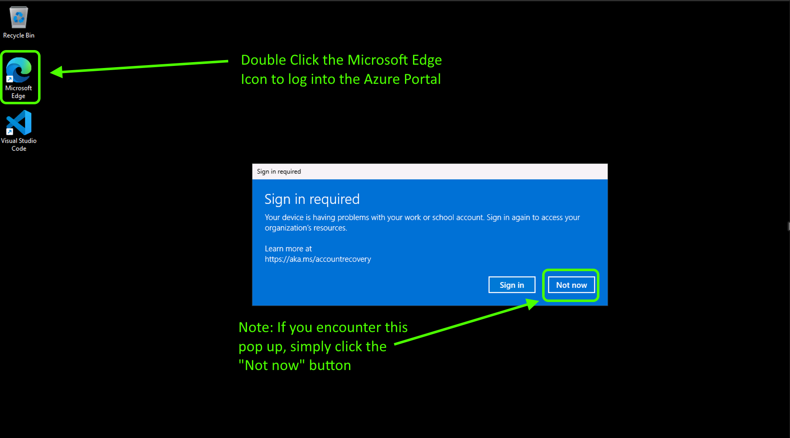

    > [!NOTE]
    > If you see a sign-in pop-up, select **Not now**.

1. To sign in to the Azure portal, enter the following credentials:

    - Username: +++@lab.CloudPortalCredential(User1).Username+++
    - TAP: +++@lab.CloudPortalCredential(User1).TAP+++

    > [!NOTE]
    > This lab uses a Temporary Access Pass (TAP) instead of a password to sign in to Azure. If you need to access this TAP code again, use the **Resources** tab at the top of these lab instructions.

1. Once you've signed in to the Azure portal, select **View all resources**.

    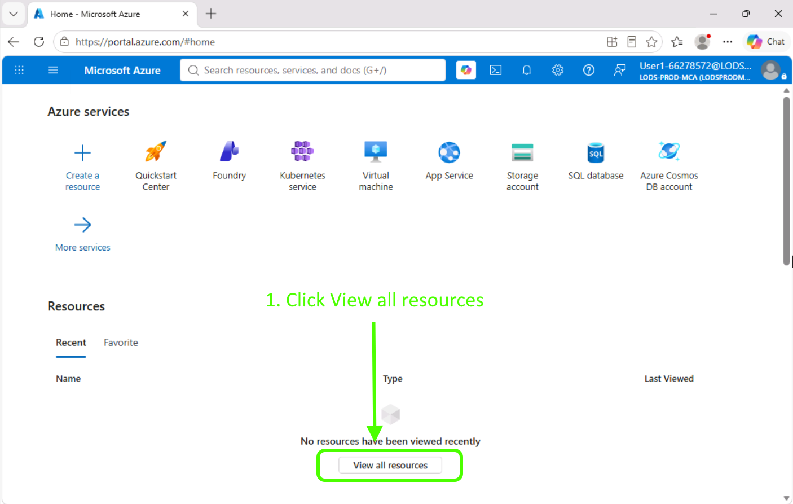

1. We'll be using these resources during this lab:
    - A Microsoft Foundry instance
    - An Azure HorizonDB database instance

    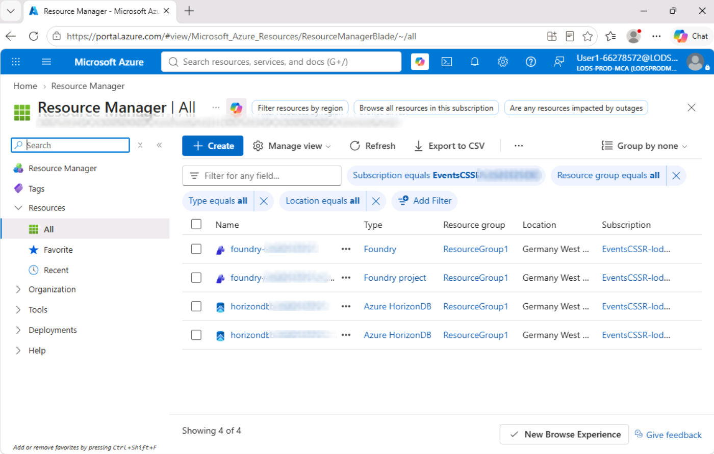

---

Your HorizonDB resource has been provisioned along with a **parameter group** containing the server parameter configuration for your PostgreSQL extensions and the associated allowlist details.

Parameter groups are a new concept in HorizonDB. They act as containers for cluster configuration values that can be applied to one or more database clusters. Instead of managing configuration settings for each cluster individually, you can define them in a parameter group and associate that group with multiple clusters to ensure consistency across your environment. This lab has only one cluster, but we still need to confirm that the parameter group has been enabled.

Parameter groups are first-class resources in Azure and are surfaced within the specific resource group and subscription defined in their resource identifier.

1. Select the HorizonDB instance in the portal.

1. Expand **Settings** in the left navigation and select **Parameters**.

1. Confirm that your parameter group has been enabled for your HorizonDB instance.

    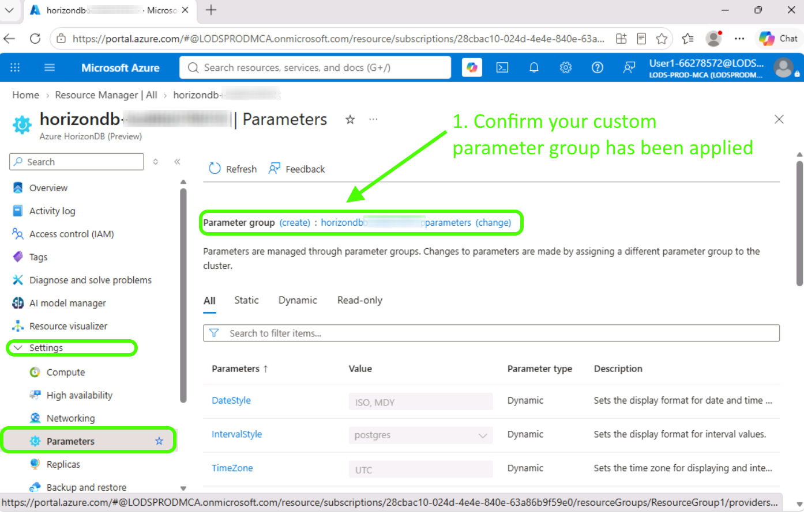

===

# Part 1 - Connect to your Azure HorizonDB database using VS Code Extension for PostgreSQL

## Open VS Code and set up a connection to Azure HorizonDB

1. Go to your desktop and double-click the **VS Code** icon to open VS Code on your lab VM.

    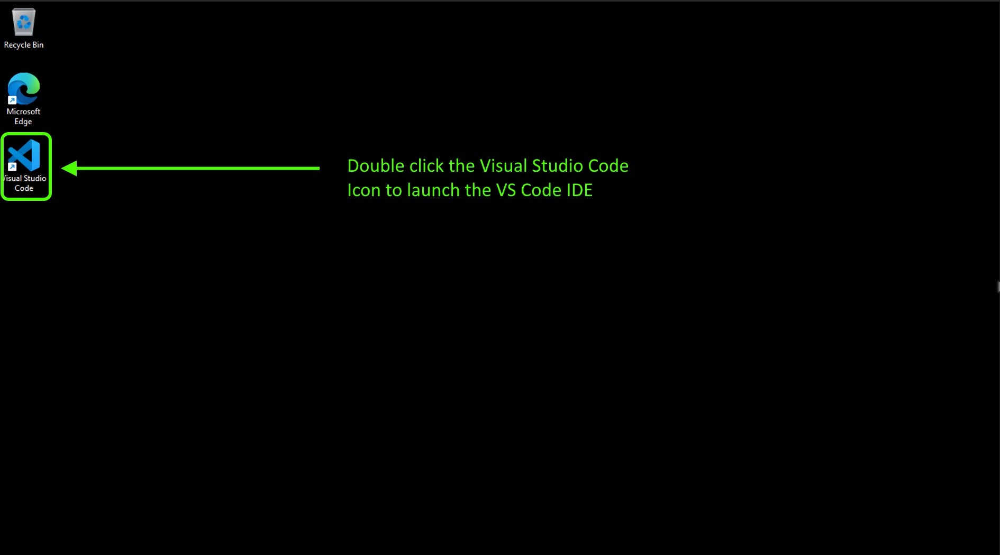

1. In VS Code, the `C:\Users\LabUsers\source\repos\ignite26-LAB692` folder should already be open. If not, select **File** > **Open Folder...** and choose `C:\Users\LabUsers\source\repos\ignite26-LAB692` to open it in your workspace.

    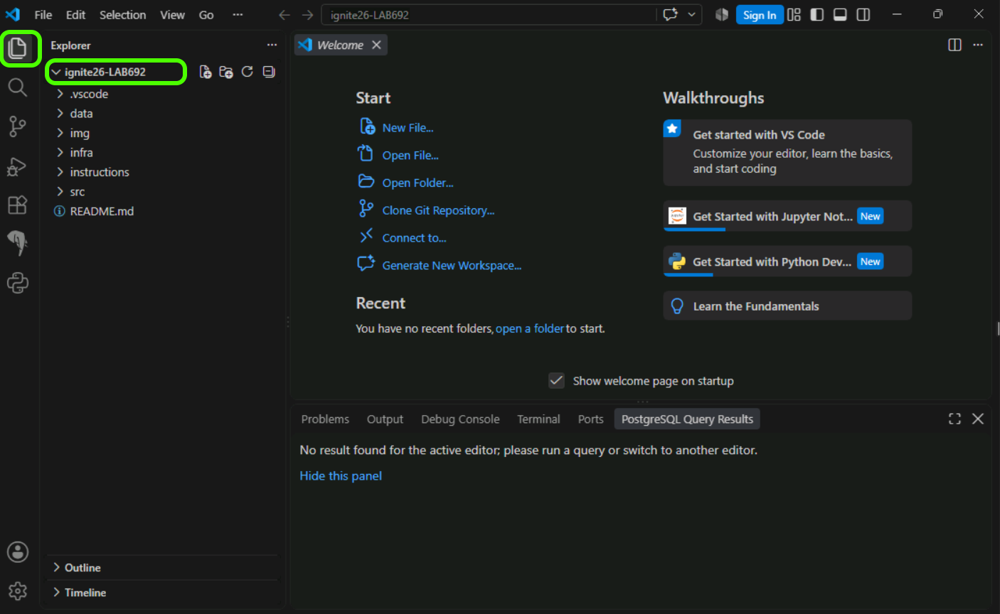

1. Select the **VS Code Extension for PostgreSQL** icon in the activity bar to open the extension.

    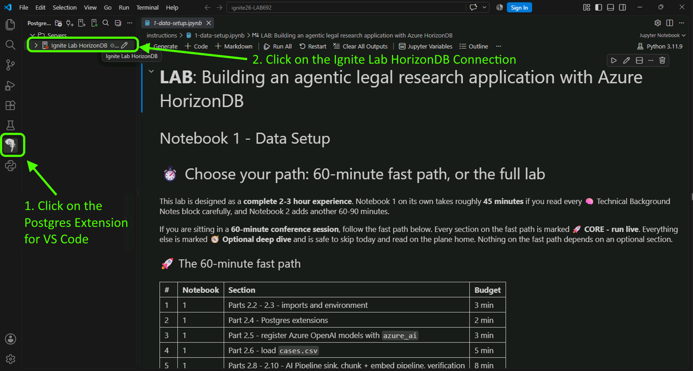

## Enter your HorizonDB password

1. Most connection details have been populated for you. Select the server connection and, when prompted, enter your lab VM **Password: +++@lab.VirtualMachine(Win11-Pro-Base).Password+++** to connect to your HorizonDB instance.

    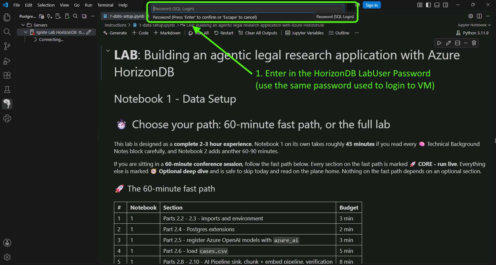

> [!NOTE]
> During lab creation, we added a firewall rule to allow connections from the lab environment to your HorizonDB instance. When setting up your own environment, configure firewall rules to allow only trusted IP addresses to reach your HorizonDB resource.

**Congratulations, you just signed in to your Azure HorizonDB database using the VS Code Extension for PostgreSQL!**

===

## Explore the VS Code Extension for PostgreSQL dashboard

1. Now that you've created a connection, let's explore the VS Code Extension for PostgreSQL and your HorizonDB database. Right-click your **Ignite Lab HorizonDB** connection and select **Dashboard** from the context menu.

    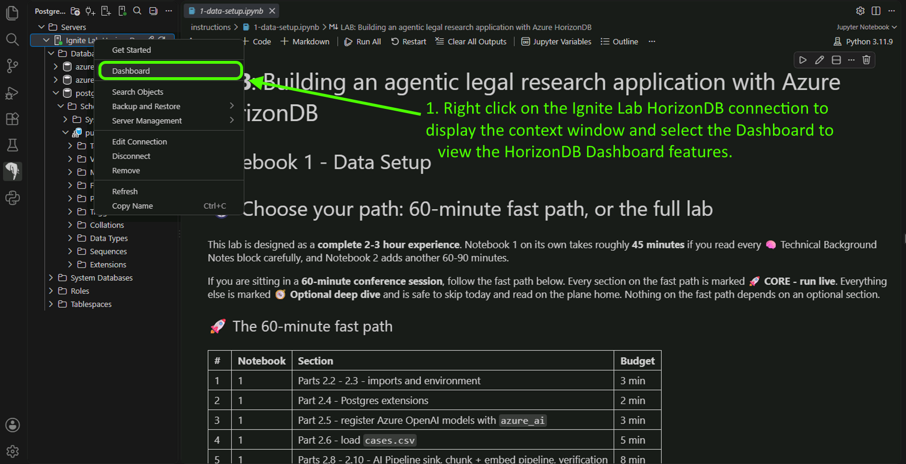

1. When the dashboard loads, review the performance details, including **wait events, disk I/O, transactions, and storage**.

1. Expand the **Databases** node under the **Ignite Lab HorizonDB** connection. Right-click the **postgres** database and select **New Query** from the context menu.

    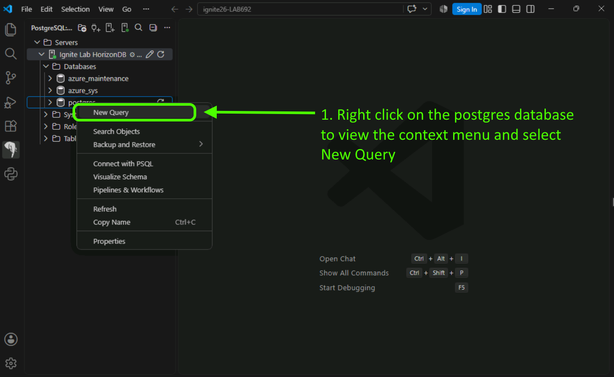

1. Copy and paste the following SQL into the query editor, then select the green play arrow at the top right to execute it. This query demonstrates how to run queries and view results using the VS Code Extension for PostgreSQL.

    During this lab, most SQL queries will be run programmatically using Python and the `psycopg` package. You'll also run a few queries using the extension's query editor.

    ```sql
    SELECT
        current_database() AS database_name,
        current_user AS connected_user,
        now() AS server_time,
        version() AS postgres_version;
    ```

    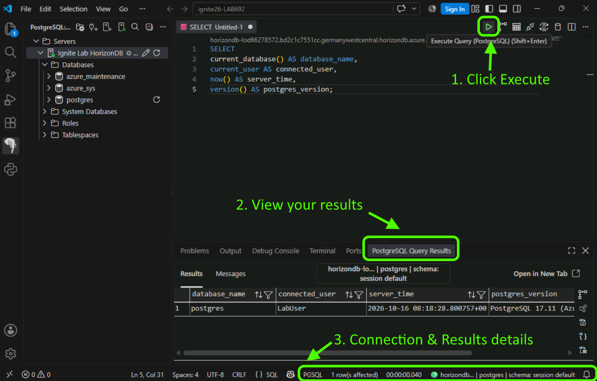

===

# Parts 2 and 3 - Data setup and agentic app development

For the remainder of the lab, you'll work through two Python Jupyter notebooks in VS Code. Each notebook contains the instructions for that part of the lab. The first notebook covers data setup, and the second covers agentic application development.

Both notebooks are located in the `instructions` folder under `C:\Users\LabUsers\source\repos\ignite26-LAB692`:

- [1-data-setup.ipynb](instructions/1-data-setup.ipynb)
- [2-app-development.ipynb](instructions/2-app-development.ipynb)

An optional third notebook helps you verify server settings and configuration:

- [3-diagnostics.ipynb](instructions/3-diagnostics.ipynb)

## Open Notebook 1 - Data setup

1. In VS Code, select the **Explorer** icon in the activity bar to return to the **Explorer** view.

    

1. Expand the **instructions** folder and double-click **1-data-setup.ipynb**.

    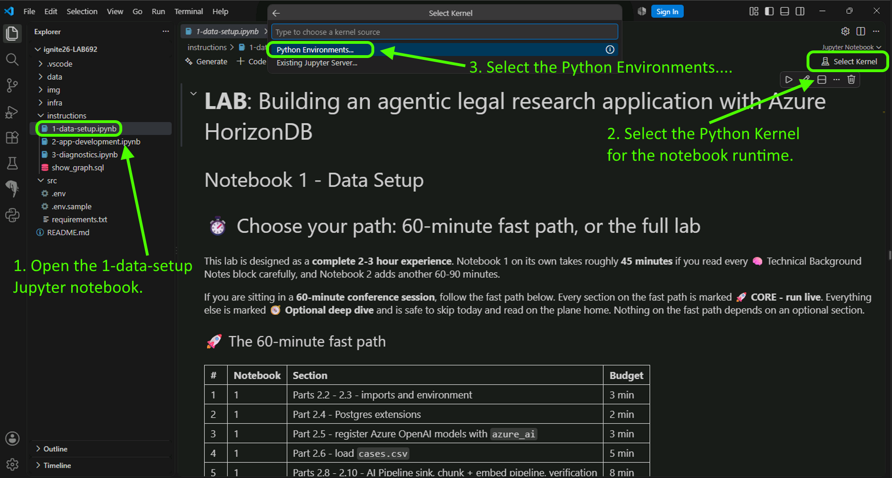

1. Read each section of the notebook and follow its instructions.

1. Select a Python kernel to execute the code cells in the notebook.

    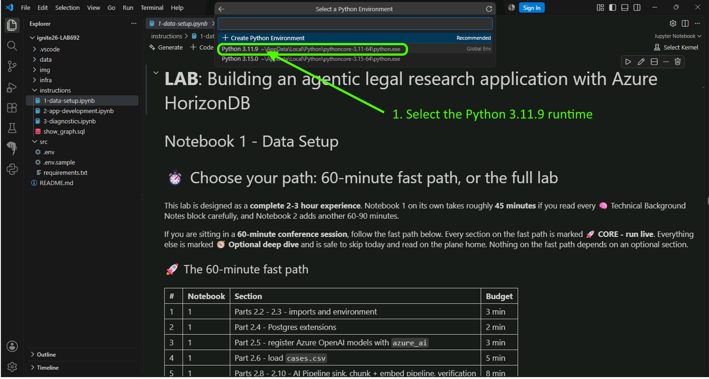

1. Once you've selected the Python 3.11.9 kernel, you can begin running the code cells in your notebooks.

    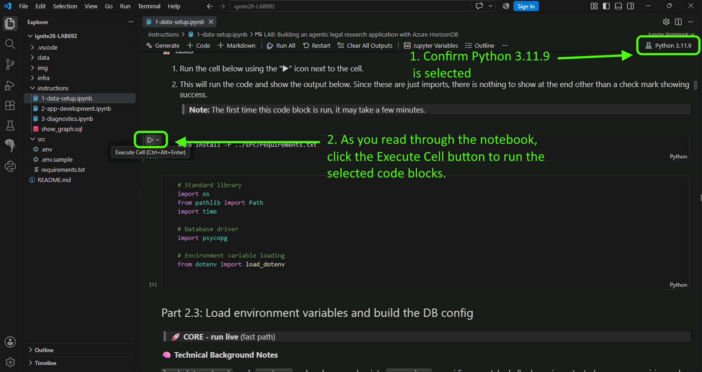

> [!IMPORTANT]
> Continue the lab by following the instructions in Notebook 1 in VS Code.

### On your own

If you're learning at your own pace:

1. Clone this repository.
2. Set up your environment using [infra/0.0-deploy-hdb.bicep](infra/0.0-deploy-hdb.bicep), then execute the four PowerShell scripts in the `infra` folder.
3. Follow the instructions above to open the Jupyter notebooks.

### 🎯 Learning outcomes

By the end of this session, you will be able to:

- Use HorizonDB's integrated AI model and AI pipeline features.
- Develop an agentic AI platform.
- Combine HorizonDB's AI capabilities with modern agentic application development to deploy a working proof of concept.

### 💻 Technologies used

- HorizonDB
- HorizonDB parameter groups
- HorizonDB native extensions
- Microsoft Foundry with GPT and embedding models
- Modern AI development libraries, including mem0

### 📚 Continue your learning

Pick your next step based on your learning style:

| Resource | What you'll get |
|----------|-----------------|
| **[Ignite 2026 Next Steps](https://aka.ms/ignite26-next-steps)** | Additional session repos and materials from Microsoft Ignite 2026 |
| **[Microsoft AI Skills Navigator](https://aka.ms/ignite26-asn)** | Discover AI skills, learning paths, and resources for your next step |
| **[Microsoft Learn](https://aka.ms/ignite26-learn)** | Official documentation and guided learning paths on these topics |
| **[Microsoft Foundry Community](https://aka.ms/MicrosoftFoundryDiscord-Ignite26)** | Connect with other learners and experts in our Discord community |

### 🌟 Microsoft Learn MCP Server

<!-- Remove this section if the Microsoft Learn MCP Server is not relevant to the session. -->

The Microsoft Learn MCP Server gives your AI agent direct access to Microsoft's official documentation — grounded, up-to-date answers about the topics in this session.

**GitHub Copilot CLI** — Install with:

```shell
copilot plugin install microsoftdocs/mcp
```

**VS Code** — One-click install:  
[](https://vscode.dev/redirect/mcp/install?name=microsoft-learn&config=%7B%22type%22%3A%22http%22%2C%22url%22%3A%22https%3A%2F%2Flearn.microsoft.com%2Fapi%2Fmcp%22%7D)

For more information, visit the [Learn MCP Server repo](https://aka.ms/learnmcp).

### 👥 Content owners

<table>
<tr>
    <td align="center"><a href="https://github.com/JaredMSFT">
        
        <br />
        <sub><b>Jared Meade</b></sub></a>
        <br />
        <a href="https://github.com/JaredMSFT" title="talk">📢</a>
    </td>
</tr>
</table>

### ⚖️ Trademarks

This project may contain trademarks or logos for projects, products, or services. Authorized use of Microsoft trademarks or logos is subject to and must follow [Microsoft's Trademark & Brand Guidelines](https://www.microsoft.com/legal/intellectualproperty/trademarks/usage/general). Use of Microsoft trademarks or logos in modified versions of this project must not cause confusion or imply Microsoft sponsorship.

Any use of third-party trademarks or logos is subject to the respective third party's policies.
